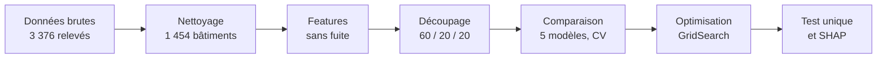
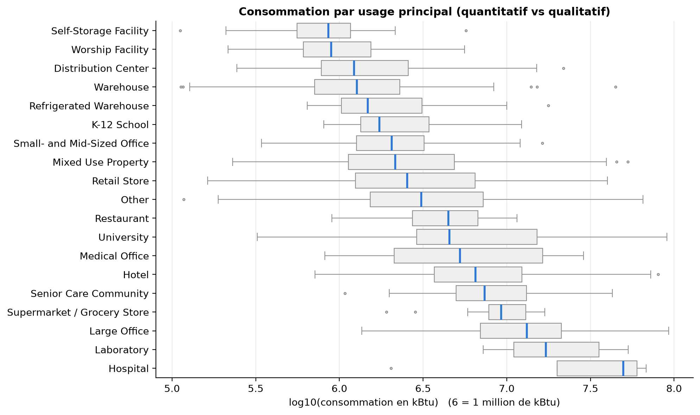
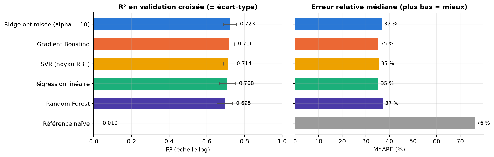
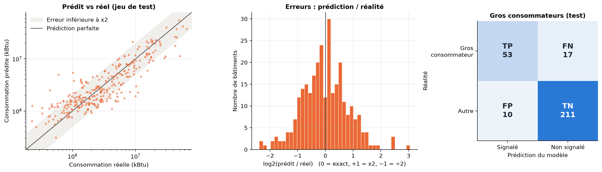
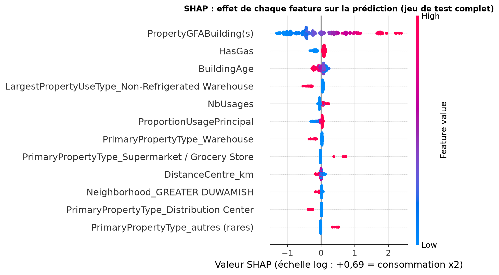

# Anticiper la consommation d'énergie des bâtiments de Seattle


**Estimer la consommation totale d'énergie d'un bâtiment non résidentiel, sans aucun relevé, à partir de ses seules caractéristiques structurelles.**

Projet 3 de la formation *AI Engineer* d'[OpenClassrooms](https://openclassrooms.com).

| 0,76 | 37 % | 79 % | 1 454 |
|:---:|:---:|:---:|:---:|
| R² sur le jeu de test (échelle log) | erreur médiane | des bâtiments estimés à un facteur 2 près | bâtiments non résidentiels modélisés |

## Le défi

Seattle vise la neutralité carbone en 2050. Pour piloter cette ambition, la ville relève la consommation de ses bâtiments, mais un relevé coûte cher. **Peut-on estimer la consommation d'un bâtiment jamais relevé à partir de ce que l'on sait de lui avant tout relevé** : surface, usage, âge, localisation, présence de gaz ou de vapeur ? Une estimation fiable permettrait de prioriser les relevés.

**Données :** 3 376 relevés de 2016 décrits par 46 colonnes (open data de la Ville de Seattle). **Cible :** la consommation totale d'énergie du site, `SiteEnergyUse(kBtu)`, modélisée en log.

## Ce qui fait la solidité du projet

- **Aucune fuite de données.** Seules les informations connues *avant* le relevé servent de features : les consommations par source, les intensités, les émissions de CO₂ et le statut de conformité sont écartés. L'ENERGY STAR Score améliorerait le R² (0,77 contre 0,72 en validation croisée), mais il est calculé à partir de la consommation à prédire : il est exclu. Toute la préparation vit dans un `Pipeline` scikit-learn ajusté sur le train uniquement.
- **Un protocole qui protège le test.** Découpage 60 / 20 / 20 stratifié sur les déciles de la cible, validation croisée à 5 folds pour comparer et choisir, jeu de test évalué **une seule fois**, à la fin.
- **Des données traitées avec méthode.** Valeurs extrêmes repérées par quantiles (percentiles de l'intensité énergétique, IQR sur la cible en log), le z-score étant comparé puis écarté. Nombres d'étages non plausibles (bâtiments à 0 étage, lieu de culte à 99 étages) : cinq méthodes d'imputation mises à l'épreuve, médiane par type d'usage retenue (juste à ±1 étage dans 67 % des cas, contre 51 % en remplaçant par 1), avec un indicateur des valeurs imputées. Encodage One-Hot plutôt que `LabelEncoder`, pour ne pas inventer d'ordre entre les usages.
- **Une comparaison à armes égales.** Référence naïve, régression linéaire puis Ridge, SVR, Random Forest, Gradient Boosting : mêmes jeux, mêmes folds, mêmes métriques (R², RMSE, MAE, erreur relative médiane). Ridge et Gradient Boosting sont optimisés par `GridSearchCV` (216 combinaisons × 5 folds pour le second, après un essai sur 10 combinaisons).
- **Des résultats lisibles côté métier.** Erreur exprimée en % et en facteur 2, lecture « gros consommateurs » par matrice de confusion, explication du modèle par importance par permutation et SHAP.

## Démarche



## Ce que montrent les données



- La **surface** est le premier facteur : en échelle log, la consommation la suit presque linéairement.
- L'**usage** change l'intensité d'un facteur 10 : environ 20 kBtu/pi² pour un entrepôt, environ 250 pour un laboratoire.
- Les bâtiments raccordés au **réseau de vapeur**, souvent de grands immeubles du centre-ville, consomment environ 3,5 fois plus en médiane. L'âge seul explique peu.

## Résultats

| Modèle | R² en validation croisée | Erreur médiane |
|---|:---:|:---:|
| Référence naïve (moyenne) | −0,02 | 76 % |
| Random Forest | 0,695 | 37 % |
| Régression linéaire | 0,708 | 35 % |
| SVR | 0,714 | 35 % |
| Ridge optimisée | 0,723 | 37 % |
| **Gradient Boosting optimisé** | **0,730** | **36 %** |



*Graphique : Gradient Boosting, SVR et Random Forest aux paramètres par défaut. L'optimisation par GridSearch porte le Gradient Boosting de 0,716 à 0,730.*

Le Gradient Boosting est retenu au meilleur R² en validation croisée ; l'écart avec la Ridge (0,730 contre 0,723) reste dans le bruit entre folds, et les deux obtiennent 0,727 sur le jeu de validation. Le Random Forest, lui, sur-apprend (0,96 en train, 0,70 en validation croisée).

**Évaluation unique sur le jeu de test :**



- **R² de 0,76** en échelle log, cohérent avec la validation croisée : pas de sur-apprentissage caché.
- **Erreur médiane d'environ 37 %** ; **79 % des bâtiments sont estimés à un facteur 2 près**, avec des erreurs équilibrées (30 surestimations, 30 sous-estimations).
- **53 gros consommateurs sur 70 repérés** (quart supérieur), pour 10 fausses alertes.
- Les erreurs les plus fortes concernent les petits bâtiments et les usages hétérogènes (« Other », entrepôts, usages mixtes).

Ce niveau de précision donne l'**ordre de grandeur** de la consommation d'un bâtiment jamais relevé et permet de **prioriser** les relevés. Il ne remplace pas un relevé.

## Ce qui pèse dans la prédiction



La cible étant en log, une valeur SHAP de +0,69 multiplie la prédiction par 2.

1. **La surface bâtie domine** : selon la taille, elle divise la prédiction jusqu'à 3,8 ou la multiplie jusqu'à 11.
2. **L'usage joue dans les deux sens** : un entrepôt réduit la prédiction d'environ 30 %, un supermarché la multiplie presque par 2.
3. **Le raccordement au gaz** ajoute environ 9 %, et l'**âge** a un effet modéré, à lire sans y voir une causalité.

## Limites et pistes

- Une seule année de relevés (2016) : les courbes d'apprentissage montrent que le Gradient Boosting profiterait de données supplémentaires.
- Un descriptif plus fin des usages aiderait sur les petits bâtiments et les catégories hétérogènes.
- La Ridge et le Gradient Boosting se complètent selon l'usage : combiner leurs prédictions est une piste d'amélioration.
- L'ENERGY STAR Score améliorerait nettement le R², mais seulement pour des bâtiments déjà relevés : il pourrait servir dans un second modèle, de suivi des bâtiments existants.

## Reproduire

```bash
poetry install            # crée le venv .venv avec toutes les dépendances
poetry run jupyter lab    # puis ouvrir les notebooks du dossier notebooks/
```

À défaut de Poetry : `pip install -r requirements.txt`, puis Jupyter. Testé avec Python 3.14, scikit-learn 1.9.1 et SHAP 0.54.1.

Les deux notebooks s'exécutent dans l'ordre. Le jeu nettoyé étant fourni dans `data/processed/`, le notebook de modélisation peut aussi être lancé seul (environ 3 minutes). Il enregistre le pipeline final dans `models/`.

## Contenu du dépôt

```
.
├── notebooks/
│   ├── P3_Analyse_Angele_Gomis.ipynb        # 1/2 · exploration et nettoyage
│   └── P3_Modelisation_Angele_Gomis.ipynb   # 2/2 · features, modèles, optimisation, interprétation
├── data/
│   ├── raw/                                 # relevés 2016 de la Ville de Seattle
│   └── processed/                           # jeu nettoyé (1 495 bâtiments × 38 colonnes)
├── reports/
│   ├── P3_Presentation_Angele_Gomis.pdf     # support de soutenance (16 slides)
│   └── figures_191026/                      # figures (les notebooks régénèrent la série complète)
├── pyproject.toml · poetry.lock · requirements.txt
└── LICENCE
```

Le suffixe `_191026` des fichiers produits par les notebooks est la date de leur version (19/10/2026).

## Auteure

**Angèle Gomis** · [@MendyData](https://github.com/MendyData)

Licence MIT, voir [LICENCE](LICENCE).
